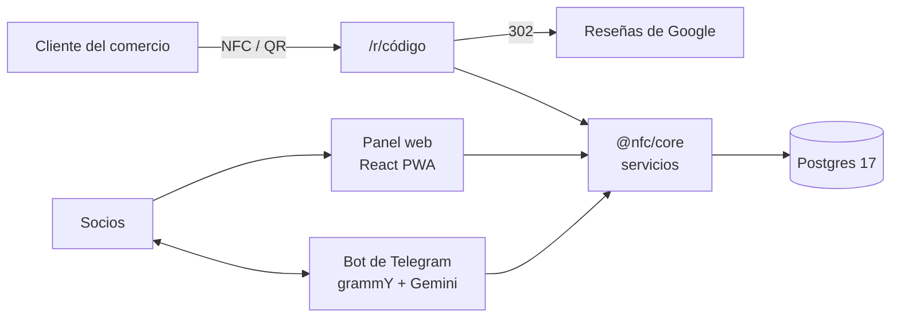

# Paneles NFC de reseñas


**La herramienta de gestión de un pequeño negocio entre amigos**: vender a comercios de barrio un soporte con placa NFC y QR que lleva a sus reseñas de Google. Los socios lo llevan todo desde un **bot de Telegram** (también en lenguaje natural) y un **panel web**. Incluye el **diseño 3D del producto físico**.

## Qué hace

| | |
|---|---|
| 💬 **Bot de Telegram** | Visitas, ventas, cobros, caja, stock y recordatorios con comandos o frases normales («vendidos 2 a Bar Pepe, cobrado»). Nada se ejecuta sin confirmar. |
| 📊 **Panel web (PWA)** | Resumen con gráficas, mapa de comercios, ficha con historia, caja, stock, placas, precios y exportación a Excel. |
| 🏷️ **Placas con código** | Cada placa redirige (`/r/<código>`) a las reseñas de su comercio y cuenta los escaneos. Se graba desde el panel con Web NFC. |
| 💶 **Cuentas claras** | Precio automático por tramos y ofertas, stock FIFO, cobros pendientes y reparto entre socios (igual, por porcentaje o por lo aportado). |
| ↩️ **Todo reversible** | Cada socio puede deshacer lo suyo durante 10 minutos. Nada se borra: se anula. |
| 🖨️ **Producto físico** | Modelo 3D (OpenSCAD) y generador de lotes con el QR y el código de cada placa para imprimir. |

## Cómo funciona



Toda la lógica de negocio vive en `@nfc/core`: el bot y el panel aplican las mismas reglas y se prueban una sola vez. Detalle en [arquitectura](docs/arquitectura.md) y [flujos](docs/flujos.md).

| Paquete | Tecnología |
|---|---|
| `packages/core` | Dominio y BD: Drizzle + Postgres 17 (dinero en céntimos, nada se borra) |
| `apps/bot` | grammY (long polling), Gemini (plan gratuito) con confirmación por botón, avisos programados |
| `apps/api` | Fastify 5: panel, acceso por ruta denegado por defecto, Excel (exceljs) y redirección de las placas |
| `apps/web` | React 19, Vite, TanStack Query, wouter, Tailwind 4, Leaflet, Web NFC |
| `hardware/soporte-nfc` | OpenSCAD + scripts Python para generar lotes |

## Empezar

```sh
pnpm install
pnpm db:up                                    # Postgres de desarrollo en 127.0.0.1:5434
cp deploy/.env.example .env                   # BOT_TOKEN de un bot de pruebas, AI_FAKE=1
pnpm tsx tools/sembrar.ts                     # datos de ejemplo
pnpm dev:api & pnpm dev:web & pnpm dev:bot
```

| Comando | Qué hace |
|---|---|
| `pnpm typecheck && pnpm test` | Tipos + tests de core, bot y API contra Postgres real |
| `pnpm --filter @nfc/web build && pnpm e2e` | e2e del panel con Playwright (axe AA, NFC simulado) |
| `node tools/deploy.mjs X.Y.Z` | Despliegue (ver [operaciones](docs/OPERACIONES.md)) |

## Estructura

```
packages/core/       esquema, migraciones (drizzle/) y servicios: ventas, caja, stock, placas, reparto, avisos…
apps/bot/            comandos.ts (texto → acción), ejecutor.ts, ia/ (Gemini), programador.ts
apps/api/            app.ts, acceso.ts (permisos), gestion.ts, excel.ts
apps/web/            paginas/, apuntar/ (asistentes por pasos), ui/
hardware/soporte-nfc modelo 3D, scripts de lotes, piezas para imprimir, ficha para la impresora
deploy/ · tools/     despliegue, copias y datos de ejemplo
```

## Documentación

Índice completo en [docs/](docs/README.md).

| Para… | Lee |
|---|---|
| Usarlo como socio | [Guía para los socios](docs/guia-socios.md) · [El negocio](docs/negocio.md) · [Novedades](docs/novedades.md) |
| Entender qué hace | [Requisitos](docs/requisitos.md) · [Flujos](docs/flujos.md) |
| Entender cómo está hecho | [Arquitectura](docs/arquitectura.md) |
| Mantener el servidor | [Operaciones](docs/OPERACIONES.md) · [Estado](docs/ESTADO.md) |
| Imprimir el producto | [hardware/soporte-nfc](hardware/soporte-nfc/README.md) |
| Programar en el repo | [AGENTS.md](AGENTS.md) |

## Licencia

Todos los derechos reservados: el código se puede consultar, pero no usar, copiar ni desplegar sin permiso. Ver [LICENSE](LICENSE).
