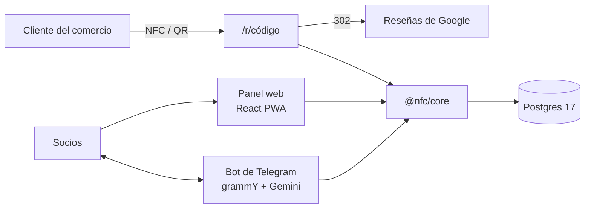

# Paneles NFC de reseñas

Negocio con amigos: vender a pequeños comercios un soporte con placa NFC y QR que lleva a sus reseñas de Google.
Los socios lo gestionan desde un **bot de Telegram** (con lenguaje natural) y un **panel web**: comercios visitados, ventas,
caja, stock, cobros, recordatorios y reparto. Cada placa lleva un código propio que redirige a las reseñas del comercio.

Diseño y detalle: [arquitectura](docs/arquitectura.md) · [requisitos](docs/requisitos.md) · [flujos](docs/flujos.md).

## Dónde está cada cosa
| Carpeta | Qué hay |
|---|---|
| `docs/` | **Para leer**: [arquitectura](docs/arquitectura.md), [requisitos](docs/requisitos.md), [flujos](docs/flujos.md), [guía para los socios](docs/guia-socios.md), [el negocio](docs/negocio.md) (precios, bonos, reparto), [estado](docs/ESTADO.md), [operaciones](docs/OPERACIONES.md), [novedades](docs/novedades.md) |
| `hardware/soporte-nfc/` | **El producto físico**: diseño 3D, scripts de lotes, piezas para imprimir, ficha para la impresora ([README](hardware/soporte-nfc/README.md)) |
| `apps/bot/` | Bot de Telegram (@asistente_billetes_bot, grupo «Billetes») |
| `apps/web/` | Panel web (nfc.redgarverde.com) |
| `apps/api/` | Servidor del panel y de las placas (`/r/<código>`) |
| `packages/core/` | Lógica común y base de datos |
| `deploy/`, `tools/` | Despliegue en el servidor casero, copias, datos de ejemplo |
| `e2e/` | Pruebas del panel en el navegador |

## Enlaces
- Panel: https://nfc.redgarverde.com (entra con `/panel` en el bot)
- Lo que se manda a la impresora: `hardware/soporte-nfc/entregas/Soporte_NFC_para_la_impresora.zip`

Para desarrollar: [AGENTS.md](AGENTS.md).

## Licencia

Todos los derechos reservados: el código se puede consultar, pero no usar, copiar ni desplegar sin permiso. Ver [LICENSE](LICENSE).
