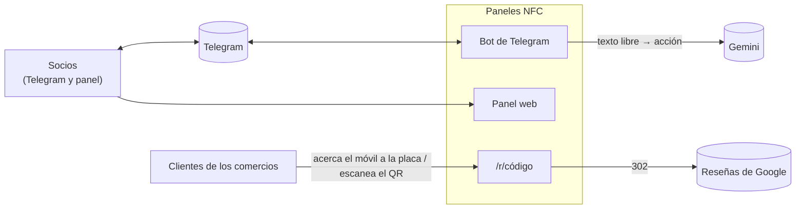
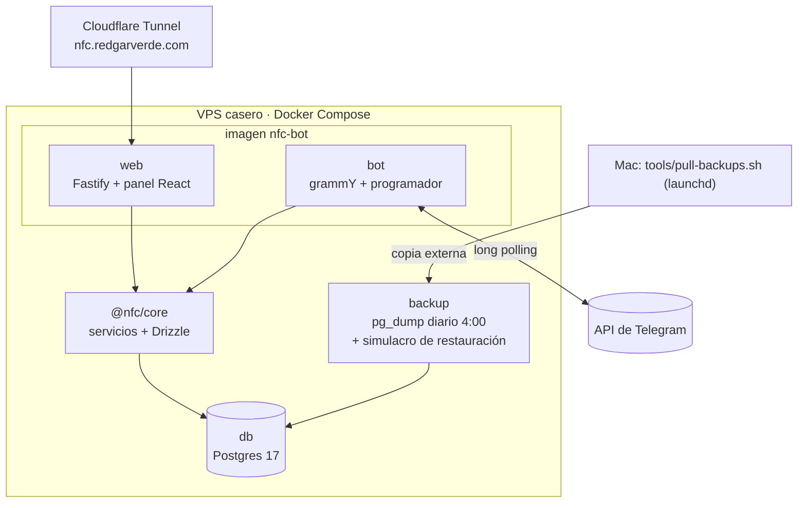
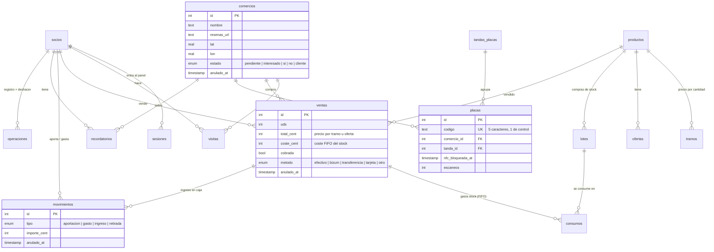
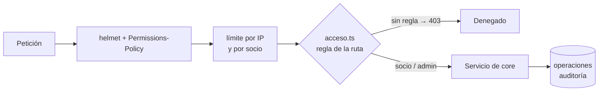

# Arquitectura

[← Documentación](README.md) · [README del proyecto](../README.md)

Un monorepo pnpm con dos procesos (bot y web) que comparten la lógica de negocio y una base de datos Postgres.

| Paquete | Qué es |
|---|---|
| `packages/core` | Lógica de negocio y base de datos: esquema Drizzle, migraciones y servicios (ventas, caja, stock, placas, reparto, avisos, recordatorios…). Los dos procesos llaman a estos servicios: ninguno escribe SQL por su cuenta. |
| `apps/bot` | Bot de Telegram (grammY): comandos, lenguaje natural con Gemini, confirmación por botón, programador de avisos y limpieza de mensajes. |
| `apps/api` | Fastify: API del panel, control de acceso por ruta, exportación a Excel y redirección de las placas (`/r/<código>`). Sirve también la web. |
| `apps/web` | Panel en React 19 + Vite + TanStack Query + wouter + Tailwind 4 (PWA): Hoy, Comercios con mapa (Leaflet), Ventas, Caja, Stock, Placas (Web NFC), Precios, Socios, Ajustes y Auditoría. |
| `hardware/soporte-nfc` | El producto físico: modelo 3D en OpenSCAD, generador de lotes (STL con el QR y el código de cada placa) y ficha para la impresora. |

## Contexto

## Contenedores

El bot y la web comparten imagen y arrancan con comandos distintos. La base de datos no tiene puerto publicado: solo la ven los contenedores de la red interna.

## Modelo de datos

El dinero va siempre en céntimos (enteros) y los porcentajes en puntos básicos. Nada se borra: los registros se anulan (`anulado_at`) y todas las consultas los filtran.

Tablas de soporte: `ajustes` (tono del asistente, limpieza, avisos), `pendientes` (peticiones para ser socio), `enlaces_panel` (códigos de entrada desde el bot), `avisos` (buzón que el bot envía cada 10 s), `efimeros` (mensajes que el bot borra solo), `envios` y `uso_ia` (consumo de Gemini).

## Seguridad

- Acceso denegado por defecto: cada ruta declara quién puede usarla y un test genera la matriz de permisos.
- Entrada por enlace mágico o código de 8 cifras que da el bot (`/panel`); cookie `__Host-sid` y cambios solo con `Origin` propio.
- Sesiones de 365 días que se renuevan con el uso; aviso por Telegram de cada inicio de sesión; «cerrar en los demás».
- Un socio solo cobra sus propias ventas, tanto en el bot como en el panel.
- `gitleaks` en un hook de pre-commit (`.githooks`).

## Decisiones

| Decisión | Por qué |
|---|---|
| Telegram como interfaz principal | Los socios ya viven en el grupo: apuntar una venta es escribir un mensaje. El panel queda para consultar y gestionar. |
| Lenguaje natural con confirmación | Gemini traduce «he vendido 2 a Bar Pepe» a una acción, pero no se ejecuta nada sin pulsar «Confirmar». |
| Lógica solo en `core` | Bot y panel aplican las mismas reglas (precio automático, FIFO de stock, permisos), y se prueban una sola vez. |
| Código corto con dígito de control | Cabe en un QR pequeño y en la tapa impresa, y detecta erratas al teclearlo. |
| Redirección 302 sin caché | Se puede cambiar el enlace de una placa ya entregada sin tocar la placa. |
| Todo se puede deshacer | Cada operación queda en `operaciones` con lo necesario para revertirla (10 min, solo lo propio). |
